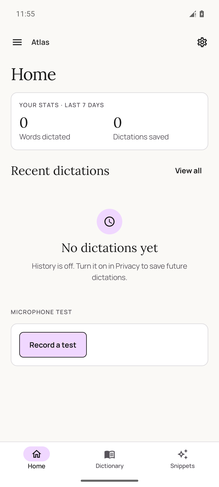
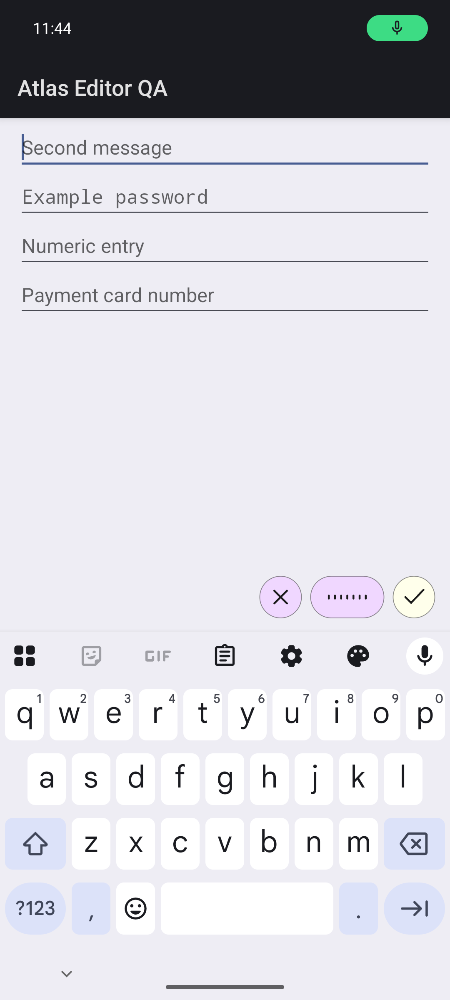
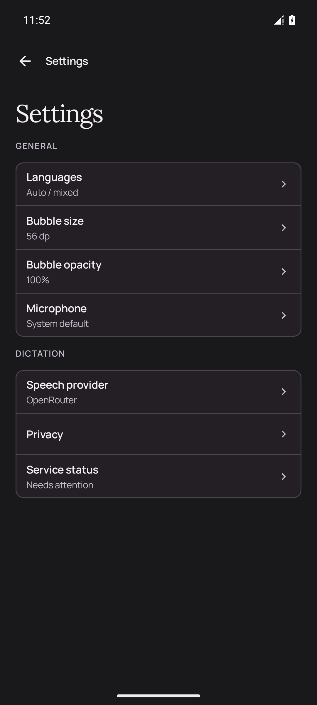

# Atlas for Android

Atlas gives you two ways to work with your voice: dictate into supported Android apps with a floating microphone, or record meetings and turn them into editable notes. It’s built with Kotlin and Jetpack Compose. Meeting recordings and saved notes are stored on your device.

**[Download the signed Atlas 0.6.0 APK](https://github.com/shreeharsh-patil/Atlas-App/releases/download/v0.6.0/meeting-atlas-0.6.0.apk)** · [Release notes and checksum](https://github.com/shreeharsh-patil/Atlas-App/releases/tag/v0.6.0) · [All releases](https://github.com/shreeharsh-patil/Atlas-App/releases)

<p>
  
  
  
</p>

## Install and get started

1. Download and open the signed APK on **Android 8.0 or later**. If Android asks for permission to install it, allow installs from the browser or file manager you used. If you already have the GitHub release installed, install the update over it to keep your data. A build signed with a different key, such as a debug build, cannot be updated in place.
2. In Atlas, follow setup to allow the microphone, enable **Display over other apps**, and review the disclosure before enabling **Atlas voice dictation** in Android Accessibility settings.
3. Go to **Dictation → Settings → Speech provider**. Choose OpenRouter or OpenAI, save your compatible speech model ID and API key, then try the microphone test. Transcription needs an internet connection and uses your provider account.
4. Open a supported text field in another app. Tap the bubble and tap **Done**, or hold it and release to submit. **Cancel** stops capture without submitting. Automatic insertion requires **Android 13 or later** and a compatible editor; use **Latest transcript → Copy** when insertion isn’t available.

## What you can do

| Dictation | Meetings |
| --- | --- |
| Dictate with your current keyboard. Adjust the bubble’s size, opacity, or position, and optionally let it shrink when idle. | Record, pause, resume, and bookmark meetings. Play, seek, or change speed later, even offline. |
| Choose Auto, English, Hindi, or Hinglish as your recognition preference. Accuracy depends on your chosen model. Add vocabulary, exact-phrase snippets, and optional cleanup. | Generate OpenRouter transcripts and evidence-linked notes. Edit notes, review revisions, browse topics, and export Markdown. |
| Search, copy, export, or delete saved dictations when local history is enabled. Retry a failed upload while the audio is still available. | Open **Meetings** or **Meeting library** from the Atlas drawer. Meetings use their own recording and model settings. |

## Privacy and limits

- Atlas starts the microphone only after you act. Accessibility is used to find a compatible focused editor and check its cursor before inserting text. Draft text and app names are not sent to your speech provider.
- Atlas sends audio only when you submit. Optional cleanup also sends the transcript, vocabulary hints, and a writing style. Provider usage can incur charges. Provider keys are encrypted using Android Keystore.
- Dictation history and audio retention start off. Meeting audio has a separate setting that can remove it after notes and evidence are saved. Turn off that setting before processing if you want to keep playback.
- Some apps use editors that don’t expose a safe insertion point. Atlas hides the bubble in fields it identifies as sensitive or restricted. Dictation uses batch transcription; live streaming and on-device speech recognition are not included.
- This release was checked on an Android 16 emulator. Live cloud dictation into WhatsApp, Chrome, and Gmail on physical devices remains unverified.

## Build and verify

Use JDK 17, Android SDK Platform 36, and the committed Gradle wrapper. On macOS or Linux, use `./gradlew` instead of `./gradlew.bat`.

```powershell
./gradlew.bat :app:assembleDebug :app:testDebugUnitTest :app:assembleDebugAndroidTest
./gradlew.bat :app:lintDebug :app:lintRelease
python tools/check_migrations.py
# With an emulator or device connected:
./gradlew.bat :app:connectedDebugAndroidTest
```

The debug APK is generated at `app/build/outputs/apk/debug/app-debug.apk`. See [release preparation](docs/release.md) for signing, [dictation setup and troubleshooting](docs/dictation.md) for permission recovery, and [visual QA](docs/dictation-ui.md) for the design, emulator captures, and screenshot checks.
